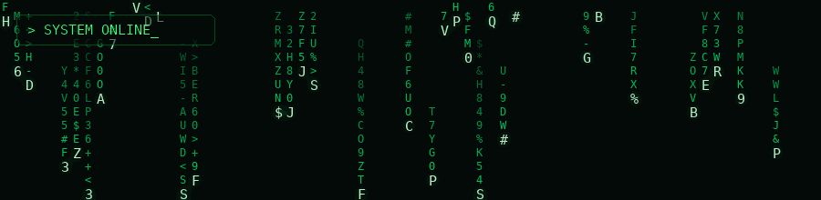

  

---

Olá, eu sou o Arthur

Estudante de **Engenharia de Software**, em transição de carreira para tecnologia. Formado em **ADS** e técnico em **Desenvolvimento de Sistemas**. Foco em **back-end**.

## 🛠️ Tecnologias

## 📂 Projetos em destaque
- **[projeto-erp-sibels-elegancia](https://github.com/arthur-fm123/projeto-erp-sibels-elegance)**: modelagem de dados (DER) de um ERP para uma pequena empresa de semijoias.
- **[projeto-erp-sibels-elegancia](https://github.com/arthur-fm123/projeto-erp-sibels-elegance)**: modelagem de dados (DER) de um ERP para uma pequena empresa de semijoias.

## 📚 Estudando agora
- API REST com Node.js + Express (CRUD)
- Modelagem e consultas SQL
- Git/GitHub em trabalho colaborativo

## 📫 Contato
[LinkedIn](https://www.linkedin.com/in/arthur-ferreira-magalhães-515743286)
